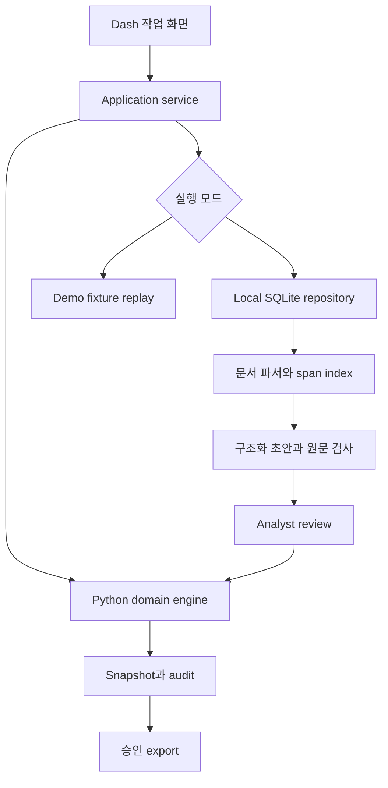

# System Architecture

Contract 1.0.0 · 다음은 제안 아키텍처이며 운영 배포 상태가 아니다.

## 구성과 데이터 흐름

Core는 UI, SQLite, OpenAI를 import하지 않는다. 입력은 검증된 도메인 객체, 출력은 새 상태·변경 이유다. UI callback은 service를 호출하고 결과를 렌더링하는 역할만 맡는다. 별도 REST API 서버를 만들지 않는다. Dash callback HTTP 자체가 서비스 경계이므로 서버 검증은 생략할 수 없다.

## 후속 구현 저장소 경로

| 경로 | 책임 |
|---|---|
| `src/orion/domain/models.py` | Pydantic 모델과 enum, unknown field 금지 |
| `src/orion/domain/{grounding,scoring,transitions,bayes}.py` | 순수 검사·계산, bayes optional |
| `src/orion/services/{workspace,review,export,budget}.py` | 권한·revision·원자적 작업 orchestration |
| `src/orion/adapters/parsers/{pdf,docx,pptx}.py` | source bytes → Document + SourceSpan 후보 |
| `src/orion/adapters/{sqlite_repo,cached_llm,openai_llm}.py` | 저장/제공자 경계. Demo에는 live adapter 생성 금지 |
| `src/orion/retrieval.py` | local deterministic token matching, span IDs 반환 |
| `src/orion/demo.py` | 불변 seed + allowlisted action replay |
| `src/orion/app.py`, `ui/`, `assets/` | Dash app, layouts, callbacks, 자체 CSS |
| `src/orion/cli.py`, `evaluation/` | ingest/seed/evaluate/export CLI, 평가 전용 gold 로더 |
| `data/synthetic/`, `data/cache/` | 생성한 synthetic 파일과 고정 초안 |
| `evaluation/gold/`, `tests/` | gold와 제품 시험, app model-input loader에서 제외 |
| `requirements*.lock`, `.github/workflows/ci.yml` | OS별 잠금과 CI |

이 경로들은 Chunk 1 이후 생성될 앱 파일 계약이다. 현 패키지에 앱이 있는 것처럼 실행하지 않는다.

## 함수 경계

| 인터페이스 | 입력 → 출력 | 실패 정책 |
|---|---|---|
| `parse_document(bytes, metadata)` | Document, SourceSpan[] | 제한 초과·불명확 locator는 실패/검토 필요 |
| `validate_grounding(state, draft)` | ValidationReport | 문서 버전, quote, offset, hash 검증 |
| `rank_questions(state, scoring_version)` | ScoreRow[] | 승인된 상태만 읽음, 외부 호출 없음 |
| `stage_update(state, candidate)` | StagedEvidenceUpdate | 현재 Snapshot 변경 없음 |
| `approve_update(repo, update, actor, expected_revision)` | CommitResult | 권한→idempotency→revision→무결성→트랜잭션 |
| `reject_update(repo, update, actor, reason)` | AuditEvent | evidence 활성화·재정렬 없음 |
| `replay_demo(case_id, actions)` | DealState, branch audit | 허용 이벤트·최대32행동만 허용 |
| `approve_export(snapshot_id, selection_digest, actor)` | AnalystDecision | 정확한 버전·선택 범위 고정 |
| `build_export(state, decision, format)` | bytes, filename, hash | 승인 불일치 시 차단 |

CommitResult는 `state_revision, snapshot_id, changed_question_ids, reason_codes, replayed`를 가진 service DTO이며 persisted entity와 구별한다. HTTP 요청의 actor_role을 신뢰하지 않고 서버에서 ActorContext를 부여한다. `reviewer`만 evidence update 및 snapshot export를 승인한다. `analyst`는 초안 수정·staging만 할 수 있다. `system`은 승인된 seed 설치만 가능하다.

## Local Live와 SQLite

Local Live는 개인 PC의 `127.0.0.1:8050`에만 bind한다. 네트워크 LAN 공개, 외부 역방향 프록시, 인증 없는 원격 사용은 지원하지 않는다. `ORION_DATA_DIR` 아래 `orion.sqlite3`, `sources/<sha256>.<ext>`, parsed text, exports를 둔다. 사용자 업로드 경로는 그대로 사용하지 않는다.

최소 테이블은 `deals`, `entity_versions`, `source_blobs`, `snapshots`, `decisions`, `audit_events`, `processed_commands`, `analysis_runs`, `budget_ledger`다. `entity_versions` PK는 `(deal_id, entity_type, entity_id, entity_version)`이고 payload는 계약 JSON이다. SQLite `CHECK(json_valid(payload))` 외의 타입·참조 검증은 application validator가 맡는다. SQL FK를 사용할 수 있는 deal, snapshot, decision, blob 키는 실제 FK로 강제한다. `PRAGMA foreign_keys=ON`, WAL, `busy_timeout=5000`을 매 connection에 적용한다.

승인은 `BEGIN IMMEDIATE` 안에서 현재 revision을 읽고 expected revision과 대조한 뒤 변경 entity version, derived claim/question, immutable snapshot, analyst decision, audit, processed command를 모두 insert하고 deals.head/revision을 갱신한다. 예외 시 전부 rollback한다. 감사행을 기존 값으로 UPDATE/DELETE하는 경로는 제공하지 않는다. DB 파일 소유자가 변조할 수 있으므로 이 구조를 불변 원장·공증이라고 부르지 않는다.

`processed_commands`는 `(deal_id,idempotency_key)` unique와 request payload hash, result revision을 저장한다. 같은 key·같은 payload는 기존 결과 반환, 같은 key·다른 payload는 `IDEMPOTENCY_CONFLICT`다. 이미 성공한 재전송은 revision 검사보다 먼저 처리한다. 처음 요청만 expected revision을 검사한다. Snapshot 계산은 transaction 안의 일관된 상태로 수행한다.

Local backup은 앱 종료 후 SQLite backup API로 DB와 source hash inventory를 함께 복사한다. 복원 시 source bytes/hash와 `head_snapshot.input_digest`를 대조한다. 운영용 암호화·백업 SLA는 제공하지 않는다.

## Strictly stateless public Demo

서버 이미지에 합성 seed, 캐시 초안, 허용 이벤트 목록을 read-only로 포함한다. 브라우저 `dcc.Store(storage_type='memory')`는 `case_id`, 이벤트 ID와 `approve/reject/reset`의 제한된 action log, 선택 행 ID만 갖는다. Python 전역에는 읽기 전용 fixture만 존재한다.

각 callback은 전체 action log를 다시 검증·재생한다. client의 state_revision, reviewer, 점수, raw evidence JSON, 파일 경로는 신뢰하거나 저장하지 않는다. event order/base revision을 서버가 결정하고 유효하지 않은 replay는 거절한다. 양 탭의 상태가 같은 구조여도 서로 접근할 서버 객체가 없으므로 교차 쓰기가 발생하지 않는다. 승인·export는 그 탭의 합성 branch 안에서만 유효하며 실사용 권한으로 해석하지 않는다.

프로세스 재시작은 seed를 그대로 복원한다. 열린 탭은 허용 action log를 재전송해 재생할 수 있고, 새로고침하면 memory store가 reset된다. 화면에 “합성 데모 · 변경은 이 탭에서만 유지”를 표시한다. 이 Demo에는 영구 DB나 cloud volume이 필요하지 않다. 반면 Local Live의 SQLite를 임시 cloud disk에 놓으면 지속성이 보장되지 않는다.

## 문서 처리와 생성 경계

파서는 subprocess 제한으로 실행하고 외부 네트워크를 사용하지 않는다. 파일 signature·형식·크기·OOXML expanded size를 확인한 후만 파싱한다. PDF reading order와 병합 표를 완벽히 복원한다고 주장하지 않는다. OCR은 optional이며 `needs_ocr` 상태가 정상적인 MVP 결과다.

LLM에 보내는 단위는 문서 전체 bytes가 아니라 허용된 source_span IDs와 짧은 추출 텍스트다. 검색은 lowercase token overlap, deterministic tie by span ID, 최대 12 spans와 12,000 input token 한도로 시작한다. 한국어 검색 품질은 evaluation에서 별도로 확인하며 개선 전 성능을 단정하지 않는다. 임베딩·도구 호출·자율 에이전트는 MVP에서 쓰지 않는다.

구조화 JSON 초안은 strict type→known references→source text integrity→analyst scope review 순서로 처리한다. 초안이 잘못되면 오류 이유를 보여주고 반려/수정한다. 최대 한 번의 형식 repair 요청도 비용 예산에 포함한다. LLM이 `approve`, `independently_verified`, 점수, SQL 또는 실행 명령을 반환해도 명령으로 사용하지 않는다.

## 배포 경계

Linux WSGI는 `gunicorn orion.app:server --workers 1 --threads 4 --bind 0.0.0.0:$PORT`를 후보로 삼는다. 서버 객체는 import 시 API key를 요구하지 않고 Demo를 안전한 기본값으로 한다. Windows는 개발 시 `python -m orion.app`, 배포 유사 smoke는 waitress를 사용한다. Gunicorn을 Windows 기본 명령으로 안내하지 않는다.

핵심 측정 로그: request_id, mode, case/deal ID, elapsed_ms, error_code, snapshot_id, input_digest, model/prompt version, token usage, cost ledger ID. raw 문서·snippet·key는 일반 로그에서 제외한다. 비용과 API 횟수는 UI를 넘어 server adapter에서 측정한다. 세부 비용·호스팅 사실 확인은 [09](09_SECURITY_COST_DEPLOYMENT.md)에 있다.
